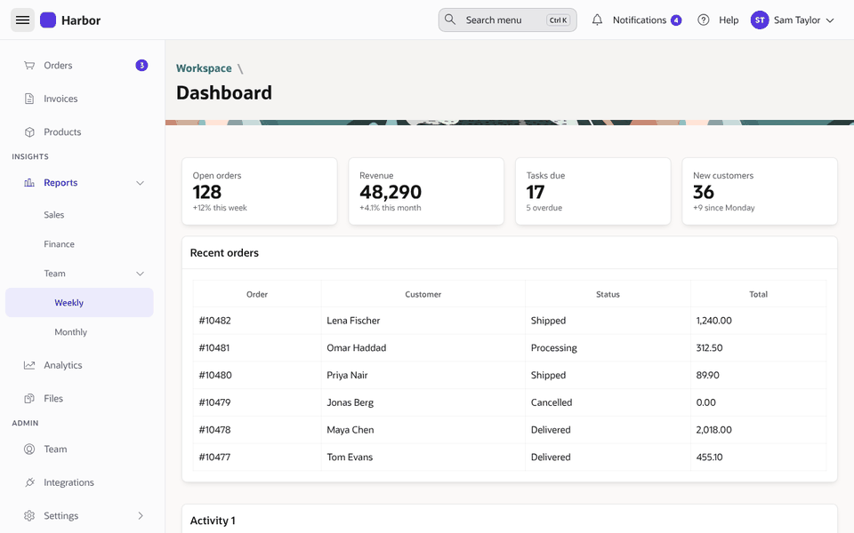
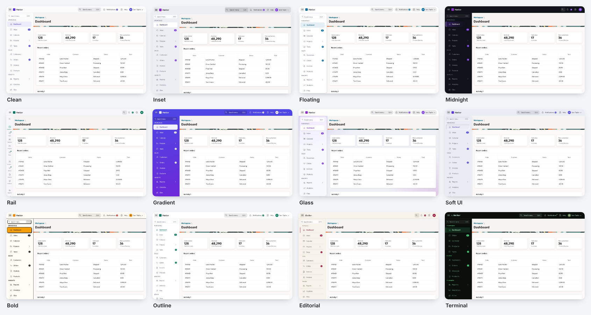
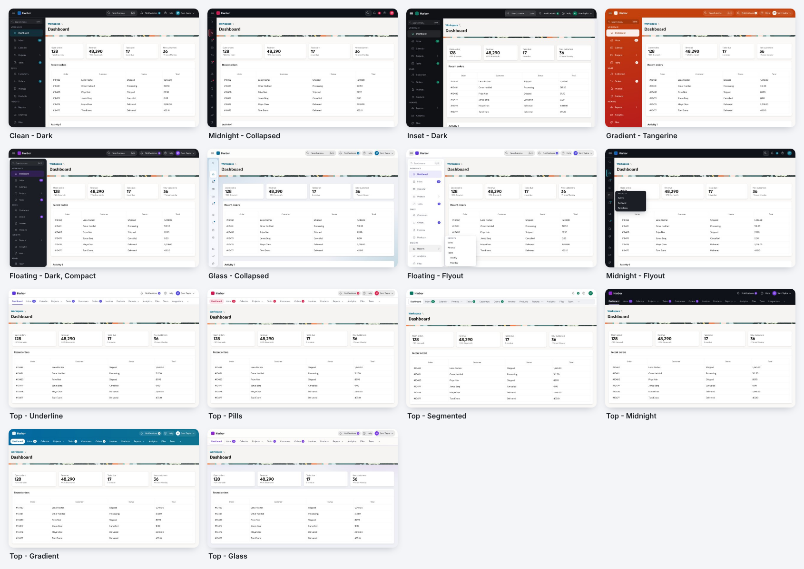
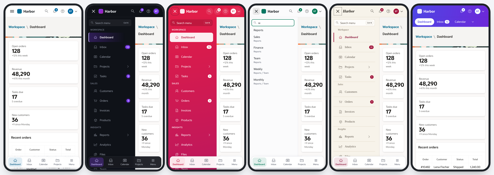
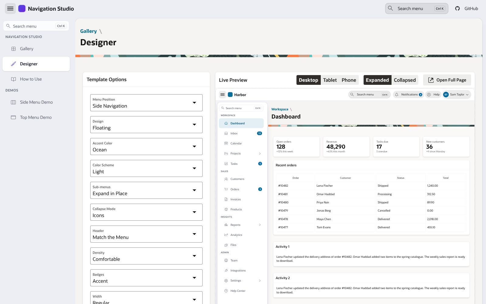

# Navigation Studio for Oracle APEX

[](https://apex.oracle.com) [](LICENSE)

Modern looks for the APEX navigation - **the side navigation menu, the top menu and the navigation bar**. 12 side menu designs, 6 top menu designs, a navigation bar that matches them, light and dark. Every look is a template option: nothing to code.



Navigation Studio is a small APEX application: a **Gallery** of ready-made looks, a **Designer** that previews every option live on phone, tablet and desktop and hands you the options as APEXlang, demo pages with a long menu, and three **list templates** that you copy into your own application:

| Template | Replaces |
|---|---|
| **Modern Side Navigation** | Side Navigation Menu |
| **Modern Top Navigation** | Top Navigation Menu |
| **Modern Navigation Bar** | Navigation Bar |

They are copies of Universal Theme's own templates with the same markup and ids, so the collapse button, keyboard, remembered state and phone overlay work as before.

## Designs

**Side menu**

| Design | Look |
|---|---|
| Clean | Quiet and light - muted entries, the current page as a tinted pill |
| Inset | Menu and header share one canvas, the content sits on a raised card |
| Floating | A detached rounded panel with small gaps |
| Midnight | A dark menu with a glowing accent edge bar |
| Rail | Collapsed, it shows a small label under every icon |
| Gradient | The menu in the accent colours, the current page in white |
| Glass | Frosted panels over a soft colour wash |
| Soft UI | Neumorphic - entries rise on hover, the current page is pressed in |
| Bold | Neo-brutalist - ink outlines and a hard shadow |
| Outline | A documentation-style tree with guide lines |
| Editorial | Paper colours, serif labels and fine rules |
| Terminal | A console - monospace, a blinking cursor |

**Top menu**: Underline, Pills, Segmented, Midnight, Gradient, Glass.

**Navigation bar**: icon and label, icons only, pills, segmented or outlined; initials avatar for the user; badges in the accent colour, red or as a dot; a search button.

Every design takes 10 **accent colours** (or your theme colour), **light / dark / follow the device**, and:

- **Section headings** - list entry attribute 3 puts a small heading above an entry (a divider when collapsed);
- **Sub-menus: expand in place or flyout** - with *Flyout*, sub-levels open in a panel beside the menu (hover, a tap on the arrow, or the Right arrow key), on the collapsed icon rail too; phones expand in place;
- **Badges** - Universal Theme's `Inbox [12]` label syntax, styled per design (accent, soft, red or dot), in the top menu too;
- **Menu search** - finds every entry, sub-levels too; <kbd>Ctrl</kbd>+<kbd>K</kbd> or <kbd>/</kbd> opens it;
- **Collapsed icon rail** with tooltips, or a menu that hides completely;
- **Phone bottom bar** - the first four entries and a Menu button, in reach of the thumb;
- a **header bar that matches the menu**, density (compact, comfortable, spacious) and width.

Text contrast is at least 4.5:1 in every design, accent and scheme (checked automatically). Right-to-left works; reduced-motion users get no animations; Windows high-contrast mode is respected.




<details><summary>On a phone</summary>


</details>

## Install

1. Download [`navigation-studio.sql`](navigation-studio.sql).
2. **App Builder > Import**, install it with any application ID. No database objects; **APEX 26.1** or later.
3. Run it - every page is public.

The APEXlang source is in [`apexlang/`](apexlang/) (`apex import -input apexlang` with SQLcl 26.1). The templates, option groups and pages are built from [`apexlang/_src`](apexlang/_src): `npm install` once, then `cd apexlang && node _src/build.mjs` (templates), `node _src/pages.mjs` (lists and demo pages) and `node _src/studio-pages.mjs` (Gallery, Designer, How to Use).

## Use it in your application

1. **Copy the templates.** In *your* application: **Shared Components > Templates > Create > List > As a Copy of an Existing Template**, copy from **Navigation Studio** and pick Modern Side Navigation (or Modern Top Navigation) and Modern Navigation Bar. Tick *Subscribe* for later updates.
2. **Upload the CSS files.** Each template loads its CSS from a static file, which the copy does not bring along. In **Shared Components > Static Application Files**, upload the matching files from [`apexlang/shared-components/static-files/navigation-studio`](apexlang/shared-components/static-files/navigation-studio) into a directory named `navigation-studio`:

   | Template | File |
   |---|---|
   | Modern Side Navigation | `navigation-studio/side-nav.css` |
   | Modern Top Navigation | `navigation-studio/top-nav.css` |
   | Modern Navigation Bar | `navigation-studio/nav-bar.css` |

   To share one copy between applications, upload them as Static Workspace Files and change `#APP_FILES#` to `#WORKSPACE_FILES#` in the `<link>` at the start of each template's *Before List Entries*.
3. **Switch to them.** **Shared Components > User Interface Attributes**:
   - *Navigation Menu* - List Template **Modern Side Navigation** (or **Modern Top Navigation** with Position *Top*) and the Template Options from the Designer;
   - *Navigation Bar* - List Template **Modern Navigation Bar** and its Template Options.

   Or paste the APEXlang the Designer gives you into `application.apx`:

```
navigationMenu {
    listTemplate: @modern-side-navigation
    templateOptions: [
        #DEFAULT#
        ns-Design--floating
        ns-Accent--ocean
    ]
    list: @navigation-menu
}
navigationBar {
    list: @navigation-bar
    listTemplate: @modern-navigation-bar
    templateOptions: [
        #DEFAULT#
        ns-Bar--pills
    ]
}
```

4. **Optional - make the most of the lists:**

| In the list | What it does |
|---|---|
| Label `Inbox [12]` | A badge (side and top menu). Use a substitution for a live count: `Inbox [&P0_UNREAD.]` |
| Menu entry attribute 3 | A section heading above the entry. In Shared Components > Lists > your list > the entry: **User Defined Attributes > 3**, e.g. *Reports*. The demo menu's WORKSPACE, SALES, INSIGHTS and ADMIN are made this way |
| Navigation bar attribute 1 | The badge value |
| Navigation bar attribute 2 | List item CSS classes - `ns-User` shows the initials avatar; `icon-only`, `no-icon` as in Universal Theme |

Texts can be translated with the text messages `MODERN_NAV.SEARCH`, `MODERN_NAV.NO_MATCH`, `MODERN_NAV.MENU` and `MODERN_NAV.QUICK_LINKS`.



## Notes

- Each template's JavaScript travels with it; its CSS is one static file (see step 2). A list template's inline CSS field holds only 4,000 bytes in the database, too small for these designs, and APEX does not emit a list template's *CSS File URLs* for the navigation menu or bar. So a `<link>` at the start of *Before List Entries* loads the file, before the menu is drawn - the menu never shows its default colours first. No CDN.
- Keep the small script in *After List Entries*: it applies the look before the menu is drawn, so nothing jumps.
- A list template's JavaScript fields hold 4,000 bytes, so the template JavaScript is minified - edit the readable sources in `apexlang/_src` and run the build.
- Color Scheme applies to the menu and the header; your theme style keeps the content. Midnight and Terminal are always dark.
- The [`qa/`](qa/) folder holds the harness used to check every design on six screen sizes against the real Universal Theme 26.1 files.

## Support

Questions, bugs and ideas: [GitHub Issues](https://github.com/HashaamShoukat/apex-navigation-studio/issues).

[MIT](LICENSE) © 2026 Hashaam Shoukat
